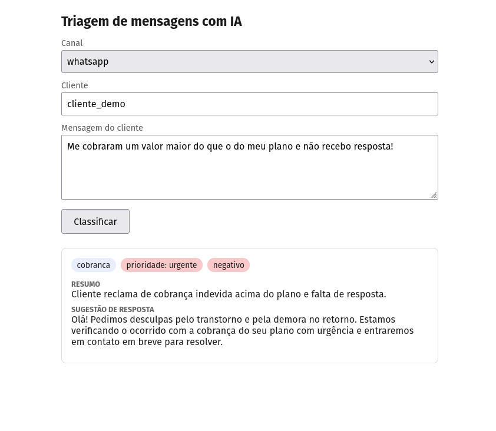

# Triagem de mensagens com IA

API que recebe mensagens de clientes (WhatsApp, e-mail, chat) e as classifica automaticamente com um LLM: **categoria, prioridade, sentimento, resumo e uma sugestão de resposta**. A ideia é ajudar um time de atendimento a ver primeiro o que é urgente.

**Demo online:** https://triagem.up.railway.app/

> A demo é pública e não tem autenticação. Use apenas dados fictícios. Ela depende da cota gratuita da API do Gemini e pode ficar fora do ar.



## Como funciona

1. O cliente envia uma mensagem (`POST /mensagens`).
2. O backend em Spring Boot pede a classificação a um serviço Python (FastAPI), que consulta o Gemini.
3. A resposta do modelo é validada contra um contrato fixo (valores permitidos para cada campo).
4. A mensagem é salva no PostgreSQL e pode ser consultada com filtros e paginação (`GET /mensagens`).

Se a IA falhar (serviço fora do ar, timeout, resposta inválida), a mensagem **não se perde**: ela é salva com `classificada = false` e os campos de classificação vazios, e a API responde normalmente.

## Arquitetura

```
Navegador / curl
      │  HTTP
      ▼
Spring Boot  (api/)  ──── JPA ────▶  PostgreSQL
      │
      │  POST /classificar  (rede privada, timeouts de 2s para conectar e 10s para ler)
      ▼
FastAPI  (ia/)  ──────────────────▶  Gemini
```

Os dois serviços são programas separados e conversam só por HTTP e JSON. O serviço Python não tem endereço público: apenas o Spring o acessa.

## Tecnologias

| Parte | Tecnologias |
|---|---|
| Backend | Java 21, Spring Boot 4.1, Spring Data JPA (Hibernate), Bean Validation, Gradle |
| Banco | PostgreSQL |
| Serviço de IA | Python, FastAPI, Pydantic, SDK `google-genai` (Gemini) |
| Front-end | HTML e JavaScript puros (uma página servida pelo próprio Spring) |
| Deploy | Railway (três serviços: `api`, `ia` e Postgres) |

## Contrato da classificação

| Campo | Valores permitidos |
|---|---|
| `categoria` | `cobranca`, `suporte`, `cancelamento`, `duvida`, `elogio`, `outro` |
| `prioridade` | `baixa`, `media`, `alta`, `urgente` |
| `sentimento` | `positivo`, `neutro`, `negativo` |
| `resumo` | texto livre, uma frase |
| `sugestao_resposta` | texto livre, rascunho de resposta ao cliente |

No Python, os valores são impostos com `Literal` do Pydantic. Se o modelo devolver algo fora do contrato, o serviço responde `502` e o Spring aplica o fallback.

## API

### `POST /mensagens`

Cria uma mensagem, classifica e salva. Campos obrigatórios: `canal`, `cliente` e `texto` (máximo de 2000 caracteres). Campos vazios retornam `400`.

```bash
curl -X POST http://localhost:8080/mensagens \
  -H "Content-Type: application/json" \
  -d '{"canal":"whatsapp","cliente":"cliente_001","texto":"Me cobraram um valor maior do que o do meu plano e não recebo resposta!"}'
```

Exemplo de resposta (`201`):

```json
{
  "id": 1,
  "canal": "whatsapp",
  "cliente": "cliente_001",
  "texto": "Me cobraram um valor maior do que o do meu plano e não recebo resposta!",
  "categoria": "cobranca",
  "prioridade": "urgente",
  "sentimento": "negativo",
  "classificada": true,
  "status": "novo",
  "criadoEm": "2026-10-15T20:40:00",
  "resumo": "Cliente reclama de cobrança indevida acima do plano e falta de resposta.",
  "sugestaoResposta": "Olá! Pedimos desculpas pelo transtorno e pela demora no retorno. Estamos verificando o ocorrido com a cobrança do seu plano com urgência e entraremos em contato em breve para resolver."
}
```

### `GET /mensagens`

Lista as mensagens, da mais recente para a mais antiga, com filtros opcionais e paginação.

| Parâmetro | Descrição |
|---|---|
| `status` | filtra por status (por exemplo, `novo`) |
| `prioridade` | filtra por prioridade |
| `categoria` | filtra por categoria |
| `page` | página, começando em 0 (padrão: 0) |
| `size` | itens por página (padrão: 20, máximo: 100) |

```bash
curl "http://localhost:8080/mensagens?prioridade=urgente&categoria=cobranca&size=5"
```

A resposta traz `content` (a lista) e `page` (`size`, `number`, `totalElements`, `totalPages`).

### `POST /classificar` (serviço Python, interno)

Recebe `{"texto": "..."}` e devolve a classificação. Fica em `ia/` e não é exposto publicamente no deploy.

## Decisões técnicas

- **Interface `Classificador` com duas implementações.** `ClassificadorMock` (regras simples, sem rede) e `ClassificadorHttp` (chama o serviço Python). A escolha é feita por configuração (`classificador.modo=mock|http`) com `@ConditionalOnProperty`, sem mudar o controller. O mock permite desenvolver e testar sem internet nem cota.
- **Falha da IA não derruba a API.** Qualquer erro na classificação é tratado: a mensagem é salva com `classificada = false` e o erro vai para o log.
- **Saída do LLM validada.** O esquema do contrato é enviado ao modelo e a resposta é validada com Pydantic antes de voltar ao Spring.
- **Texto do cliente tratado como dado.** O prompt delimita a mensagem e instrui o modelo a não seguir instruções contidas nela, para reduzir o risco de *prompt injection*. Isso reduz o risco, mas não o elimina.
- **Filtros opcionais em uma só consulta JPQL**, com `(:param IS NULL OR campo = :param)`, e paginação com tamanho máximo para evitar respostas enormes.
- **Segredos fora do repositório.** Chaves e senhas ficam em arquivos `.env` (ignorados pelo Git) ou nas variáveis do Railway.
- **Página sem risco de XSS.** O front-end usa `textContent` ao exibir o texto das mensagens.

## Avaliação da classificação

O script `ia/avaliar.py` envia as 25 mensagens de `dados/mensagens_seed.json` ao serviço de IA e compara o resultado com o campo `esperado` de cada uma.

Resultado de uma execução:

| Campo | Acertos |
|---|---|
| `categoria` | 25/25 (100%) |
| `prioridade` | 20/25 (80%) |
| `sentimento` | 22/25 (88%) |

**Como interpretar:**

- Não é um benchmark. São 25 mensagens fictícias, criadas com ajuda de IA, e os rótulos esperados foram definidos de forma subjetiva e sem validação independente.
- As divergências concentram-se em campos subjetivos, como a fronteira entre prioridade `media` e `alta`, ou se uma mensagem educada é `neutra` ou `positiva`.
- O modelo não é determinístico, então os números podem variar entre execuções.
- O prompt não foi ajustado para acertar esse conjunto.

<details>
<summary>Divergências da execução (esperado → obtido)</summary>

- Mensagem 02: sentimento `neutro` → `positivo`
- Mensagem 10: sentimento `neutro` → `negativo`
- Mensagem 12: prioridade `media` → `alta`
- Mensagem 17: prioridade `media` → `alta` (o prompt trata pedido de cancelamento como `alta`)
- Mensagem 18: prioridade `media` → `alta`
- Mensagem 23: prioridade `media` → `baixa` e sentimento `neutro` → `positivo`
- Mensagem 25: prioridade `baixa` → `media`

</details>

Para rodar: com o serviço de IA no ar em modo `llm`, execute `python avaliar.py` dentro de `ia/`.

## Como rodar localmente

**Pré-requisitos:** JDK 21, PostgreSQL, Python 3.10+ e uma chave de API do Gemini (opcional se usar o modo mock).

**1. Banco de dados.** Crie um banco vazio (por exemplo, `triagem`). O Hibernate cria a tabela `mensagens` na primeira execução (`ddl-auto=update`). Em PostgreSQL 15 ou mais novo, o usuário do banco precisa ter permissão no schema `public`.

**2. Serviço de IA (`ia/`).**

```bash
cd ia
python -m venv .venv
source .venv/bin/activate          # Windows: .venv\Scripts\activate
pip install -r requirements.txt
```

Crie `ia/.env`:

```
IA_MODO=llm                        # ou "mock" para rodar sem chave
GEMINI_API_KEY=sua_chave
GEMINI_MODELO=gemini-3.5-flash-lite   # opcional
```

```bash
uvicorn main:app --port 8000 --reload
```

**3. Backend (`api/`).** Crie `api/.env`:

```
LINK_DB=jdbc:postgresql://localhost:5432/triagem
USER_DB=seu_usuario
SENHA_DB=sua_senha
```

Em `api/src/main/resources/application.properties`, defina `classificador.modo=http` e `classificador.url=http://localhost:8000` (ou `classificador.modo=mock` para não depender do serviço Python).

```bash
cd api
./gradlew bootRun
```

Acesse `http://localhost:8080/` para a página de triagem.

## Deploy (Railway)

Um projeto com três serviços a partir deste repositório:

| Serviço | Root Directory | Observações |
|---|---|---|
| `Postgres` | — | banco gerenciado pelo Railway |
| `ia` | `/ia` 
| `api` | `/api`

## Estrutura do repositório

```
triagem/
├── api/      # Spring Boot (controller, entidade JPA, repositório, classificadores)
├── ia/       # FastAPI (serviço de classificação) e script de avaliação
├── dados/    # mensagens_seed.json: 25 mensagens fictícias com a classificação esperada
└── docs/     # imagens do README
```

## Como usei IA no desenvolvimento

Usei o Claude como assistente durante o projeto: para tirar dúvidas de conceitos (JPA, paginação, FastAPI, integração entre serviços), revisar o meu código, apoiar o diagnóstico de erros de configuração e de deploy, e gerar o conjunto de 25 mensagens de teste. Revisei e testei o que foi sugerido antes de usar.

